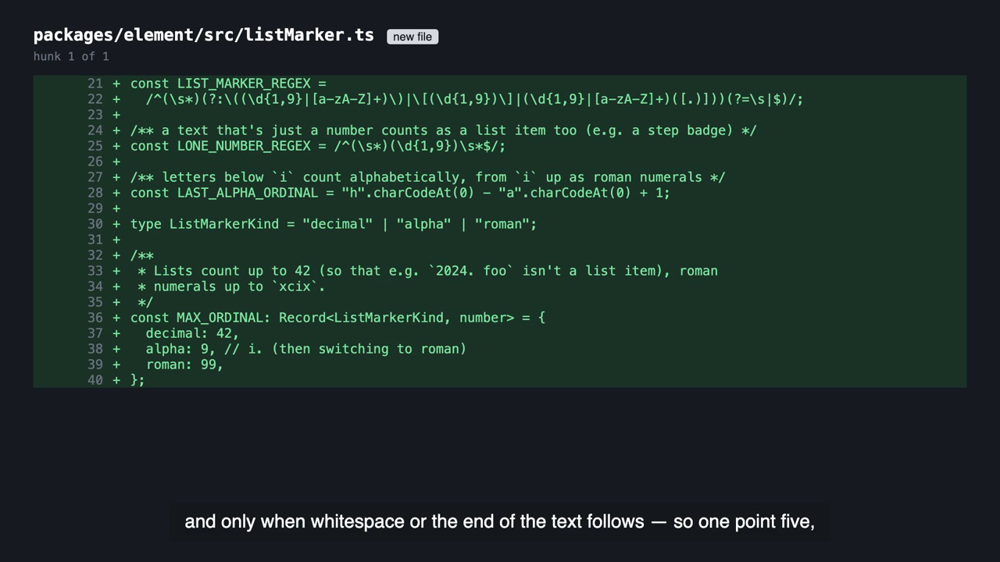
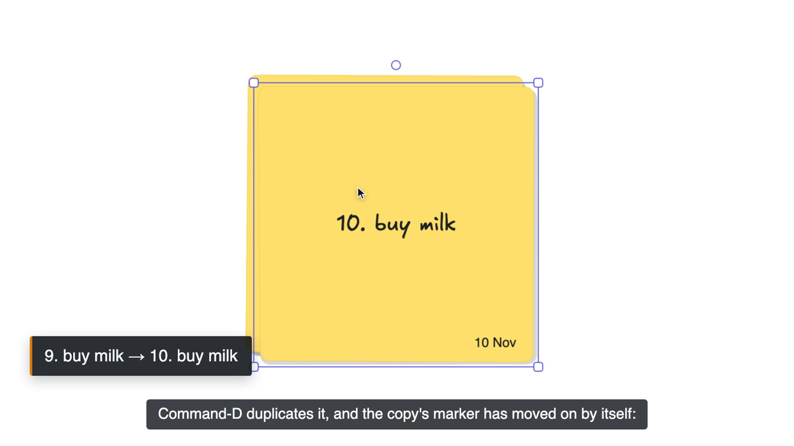
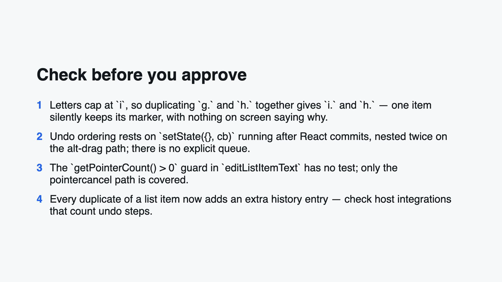
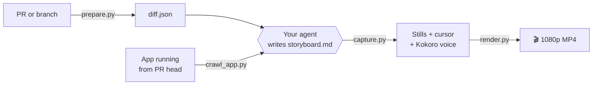

<div align="center">

# lgtm-kit

**Your coding agent wrote the PR in ten minutes. Now let it explain the PR to you.**

Agent skills that turn AI-written pull requests into something a human can actually review.

[](https://github.com/ashish-ty/lgtm-kit/actions/workflows/ci.yml)
[](LICENSE)
[](#install)
[](#privacy)

https://github.com/user-attachments/assets/6a3e7f52-a69f-40bb-91bb-6528cd9e119b

<sub>▲ Made by <code>pr-video</code> from a real merged PR: <a href="https://github.com/excalidraw/excalidraw/pull/12189">excalidraw#12189</a>. No one recorded a screen.</sub>

</div>

---

## Ask for a video, get a review in under 3 minutes

```text
> make a PR video for #12189
```

Your agent reads the diff, writes a storyboard, films the running app, narrates it with a local
voice and hands you an MP4. You watch it before you open the diff.

<table>
  <tr>
    <td width="33%"></td>
    <td width="33%"></td>
    <td width="33%"></td>
  </tr>
  <tr>
    <td align="center"><b>The code that matters</b><br><sub>2–5 hunks cut from the real diff, explained in plain words</sub></td>
    <td align="center"><b>The real app, filmed</b><br><sub>The PR's claim, checked on screen: 9 becomes 10 on the copy</sub></td>
    <td align="center"><b>What to check before you approve</b><br><sub>Honest doubts, not a summary of the description</sub></td>
  </tr>
</table>

## Why

Coding agents can open a 3,000-line PR before lunch. Reading it still takes an afternoon, and
"LGTM" on a diff you skimmed is how bugs ship. Generic AI review comments don't help much. What
you need is the **story of the change**: what it does, the few lines that carry it, the behaviour
on screen and what still needs a human eye.

## Skills

| Skill | What it does | Status |
|---|---|---|
| 🎬 [**pr-video**](skills/pr-video/SKILL.md) | A narrated walkthrough video (≤ 3 min) of any PR or branch: code cards, the running app filmed with a synthetic cursor and a local AI voiceover | **v0.1** |

## Install

**Claude Code** (plugin marketplace)

```text
/plugin marketplace add ashish-ty/lgtm-kit
/plugin install lgtm-kit@lgtm-kit
```

**Any agent**, via the community [skills CLI](https://github.com/vercel-labs/skills)

```bash
npx skills add ashish-ty/lgtm-kit                  # asks which agents to install into
npx skills add ashish-ty/lgtm-kit -a opencode -g   # or name them
```

<details>
<summary><b>By hand:</b> clone and symlink into your agent's skills folder</summary>

```bash
git clone https://github.com/ashish-ty/lgtm-kit ~/src/lgtm-kit
ln -s ~/src/lgtm-kit/skills/pr-video ~/.claude/skills/pr-video
```

| Agent | Global skills folder | Project skills folder | Tested |
|---|---|---|---|
| Claude Code | `~/.claude/skills/` | `.claude/skills/` | ✅ |
| Gemini CLI | `~/.gemini/skills/` | `.gemini/skills/` or `.agents/skills/` | ⏳ before v0.1 |
| OpenCode | `~/.config/opencode/skills/` | `.opencode/skills/` | ⏳ before v0.1 |
| Codex CLI | `~/.codex/skills/` | `.agents/skills/` | should work |
| Cursor | — | `.cursor/skills/` | should work |

The skills only ask the agent to run shell commands and write files, so any agent that can do
both can drive them.

</details>

### Requirements

| | |
|---|---|
| [`uv`](https://docs.astral.sh/uv/) | Every script declares its own dependencies (PEP 723), so nothing gets installed into your repo |
| Node 18+ | Remotion installs itself on the first render |
| [`gh`](https://cli.github.com/), signed in | To read PRs by number (or use `--base main --head <branch>`) |
| Chrome *or* `uvx playwright install chromium` | Only for filming the live app |
| ~120 MB of disk | The Kokoro voice model, fetched and checksum-verified on the first run |

Tested on **macOS**. Linux runs the test suite in CI. Windows: use WSL.

## How it works



The agent does the thinking: which hunks matter, what to show live and what to doubt. The
scripts only do mechanical work, and they **refuse a storyboard that can't be carried out**,
before a browser opens. If a screen the PR promises isn't there, the run stops and reports it as a
**finding**. It never fakes the shot.

- **Real things only.** Code cards are the real diff, and numbers in captions are read off the screen.
- **≤ 3 minutes, enforced.** A longer storyboard is refused, with the longest beats named.
- **Backend-only PR?** You get a cards-only video.
- **English subtitles** of the narration are burned in, and written beside the MP4 as an `.srt`
  (`--no-subtitles` turns them off).
- Output goes to `<repo>/.pr-videos/`, which ignores itself in git.

## Privacy

Everything runs on your machine. Nothing is uploaded, nothing gets posted, nothing gets merged.

- The voice is [Kokoro](https://github.com/thewh1teagle/kokoro-onnx) and runs locally.
  [edge-tts](https://github.com/rany2/edge-tts) is an opt-in fallback that **sends the narration
  text to Microsoft**, so it only runs with `--allow-edge`.
- Sign-in sessions for live capture are kept in `~/.pr-video/`, never in your repo.

## ⚠️ Remotion license

pr-video renders with [Remotion](https://www.remotion.dev/license). Remotion is free for
individuals and for companies of **up to 3 people**; larger companies need a
[Remotion company license](https://www.remotion.dev/license). lgtm-kit's own code is MIT, but that
doesn't cover Remotion. Check before you use pr-video at work.

## Contributing

Issues and PRs are welcome. To run the checks CI runs:

```bash
cd skills/pr-video
uv run --python 3.12 --with pytest --with pyyaml --with pillow --with tinytag pytest -q
(cd remotion && npm ci && npm run typecheck)
uvx ruff check ../../skills
```

The browser end-to-end test runs when Playwright is installed. Set `PR_VIDEO_E2E_RENDER=1` to also
render the MP4.

## Credits

- Demo: [excalidraw/excalidraw#12189](https://github.com/excalidraw/excalidraw/pull/12189)
  (MIT), filmed from a local build at the PR head.
- Voice: [Kokoro-82M](https://github.com/hexgrad/kokoro) (Apache-2.0) via
  [kokoro-onnx](https://github.com/thewh1teagle/kokoro-onnx) (MIT).
- Rendering: [Remotion](https://www.remotion.dev). Browser: [Playwright](https://playwright.dev).

## License

[MIT](LICENSE) © 2026 Ashish Tyagi
